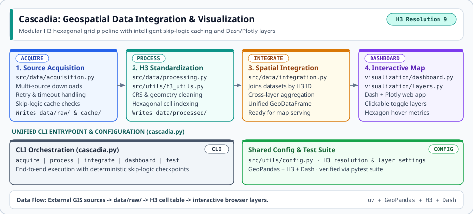

# Cascadia

Cascadia acquires geospatial inputs, aggregates their values into H3 cells,
joins the resulting datasets, and visualizes exported layers in Dash.

Start with the [documentation index](docs/README.md). It links to
[installation and usage](docs/usage.md), an [offline example](docs/usage.md#try-the-offline-example),
and the [software methods manuscript](docs/manuscript/README.md).

The [citation metadata](CITATION.cff) identifies the software. The
[backlog](TODO.md) records open implementation questions.

Licensed under the [MIT License](LICENSE).
